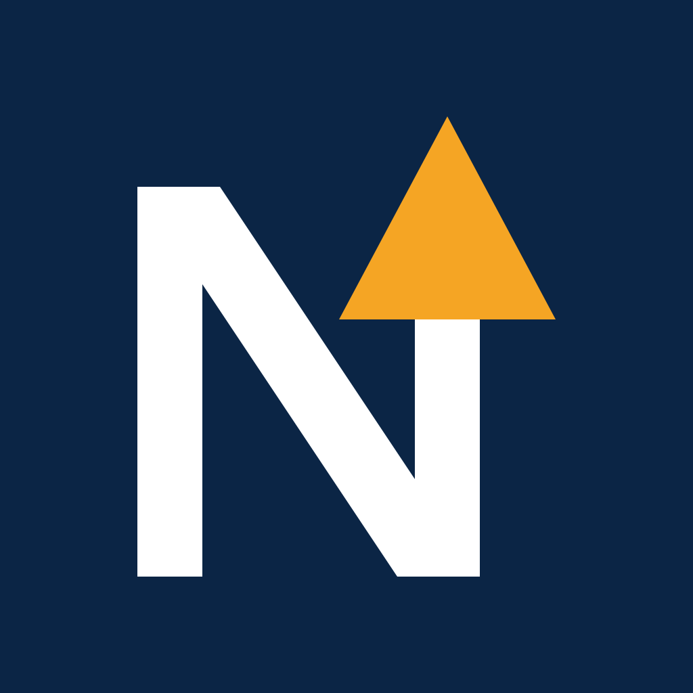

<p align="center">
  
</p>

<h1 align="center">Northbid</h1>

<p align="center">
  Search Government of Canada tenders, contract awards and standing offers from your AI assistant.
</p>

<p align="center">
  <a href="https://www.npmjs.com/package/northbid"></a>
  <a href="https://github.com/hexacron/northbid/actions/workflows/ci.yml"></a>
  
  
  <a href="LICENSE"></a>
</p>

<p align="center">
  <strong>English</strong> | <a href="README.fr.md">Français</a>
</p>

Search Government of Canada procurement data from your AI assistant. Northbid is a local [Model Context Protocol](https://modelcontextprotocol.io) server that loads the open data published by [CanadaBuys](https://canadabuys.canada.ca/en/procurement-and-contracting-data) into a small database on your computer and gives the assistant tools to search it, in English or French.

It works with Claude Code and Cowork, Codex and the ChatGPT desktop app, Gemini CLI, and any other client that can run a local MCP server. It is free, needs no account, and has no dependencies beyond Node.js.

> **Unofficial.** Northbid is not affiliated with or endorsed by the Government of Canada, CanadaBuys or Public Services and Procurement Canada. The CanadaBuys website is the authoritative source; confirm every detail there before you bid.

## Example

> **You:** Which suppliers won the most translation work since April 2025?

The assistant calls `summarize_awards` with `{"group_by": "supplier", "query": "translation OR traduction", "awarded_after": "2025-04-01"}` and answers from the result:

> 171 award notices matched, worth $44.9 million in total across 114 suppliers. The top three by value:
>
> | Supplier | Awards | Total value (CAD) | Largest award (CAD) |
> |---|---|---|---|
> | R&R International Translation Specialists Inc. | 5 | $8,146,105 | $7,342,315 |
> | SYM Communications Inc. | 8 | $4,560,685 | $1,437,188 |
> | Adirondack Information Management Inc. | 1 | $3,749,340 | $3,749,340 |
>
> 89 of the 171 notices carry no value, mostly standing offers and supply arrangements, so treat the totals as indicative.

The figures are real tool output from the data of 17 November 2026. The wording of the answer depends on your assistant.

## Requirements

Node.js **22.16 or newer** (24 or newer recommended). Check with `node --version`. Node 23 is not supported because its built-in SQLite lacks full-text search.

## Install

### Claude Code and Cowork

```
/plugin marketplace add hexacron/northbid
/plugin install northbid@northbid
```

The plugin adds the server and a `find-opportunities` skill. Local MCP servers do not run in claude.ai chat on the web; there you get the skill only.

### Codex and the ChatGPT desktop app

```bash
codex mcp add northbid -- npx -y northbid
```

Codex and the ChatGPT desktop app share this configuration.

### Gemini CLI

```bash
gemini extensions install https://github.com/hexacron/northbid
```

### Any other MCP client

Register a stdio server that runs `npx -y northbid`. This fetches the package from npm, so there is nothing to clone:

```json
{
  "mcpServers": {
    "northbid": { "command": "npx", "args": ["-y", "northbid"] }
  }
}
```

To run from source instead, clone the repository and use `node /absolute/path/to/northbid/server/index.js`. [docs/clients.md](docs/clients.md) has the configuration for each client and notes on what has been tested.

## What you can ask

- "Find open federal tenders for translation services I could deliver in Ontario."
- "What IT security opportunities close in the next three weeks? Show the selection criteria for the top three."
- "Quels appels d'offres fédéraux sont ouverts pour des travaux de construction au Québec ?"
- "Which suppliers hold standing offers for light duty vehicles, and when do they expire?"
- "Who won the last snow removal contracts at CFB Petawawa, and for how much?"
- "Which suppliers won the most translation work since April 2025?"

## What it covers

| Dataset | Records | Source refresh |
|---|---|---|
| Open tender notices | about 950 | daily, plus new notices every 2 hours |
| Active standing offers and supply arrangements | about 4,000 agreements | weekly |
| Award notices since August 2022 | about 30,000 | daily |

Federal organizations only. Contract amendments, closed tenders and the archives before August 2022 are on the [roadmap](#roadmap). See [docs/data.md](docs/data.md) for the schema and known quirks.

## Tools

| Tool | What it does |
|---|---|
| `search_tenders` | Search open tenders by keyword, buyer, category, UNSPSC code, delivery region and dates |
| `get_tender` | Full record for one tender: description, criteria, trade agreements, contact, attachments |
| `search_standing_offers` | Search standing offers and supply arrangements by keyword, supplier, department, commodity |
| `search_awards` | Search contract awards by keyword, supplier, buyer, category, UNSPSC code, region, value and dates |
| `get_award` | Full record for an award: supplier, value, contract dates, procurement method, description |
| `summarize_awards` | Count awards and total their value by supplier, buyer or year |
| `data_status` | Show what is loaded and how current it is |
| `refresh_data` | Check CanadaBuys for newer files now |

Search matches English and French text at once and ignores accents. Full parameters and sample output are in [docs/tools.md](docs/tools.md).

## What it does on your computer

- **Downloads** CSV files from `canadabuys.canada.ca` and `sosa.canadabuys.canada.ca`: three files of about 10 MB in total on first use, and five more of about 110 MB in total the first time you ask about contract awards. It then re-checks them on a schedule and downloads only what changed. One of those hosts serves an incomplete certificate chain, so the missing issuer certificate is fetched from the address named in the certificate (currently `crt.sectigo.com`) and verified against Node's trusted roots.
- **Stores** the data in one SQLite file in the plugin's data directory, or your operating system's cache directory when run outside Claude. It grows to about 165 MB once awards are loaded. Deleting the file is safe; it is rebuilt on next use.
- **Sends nothing else.** Your searches and conversations stay on your machine. There is no telemetry and no account. See [PRIVACY.md](PRIVACY.md).

Settings, all optional environment variables:

| Variable | Effect |
|---|---|
| `NORTHBID_DATA_DIR` | Where to keep the database |
| `NORTHBID_OFFLINE=1` | Never contact the network; use the data already downloaded |

## Troubleshooting

- **"northbid needs Node.js 22.16 or newer"**: the `node` on your PATH is too old, or is a 23.x release. Install a current LTS release.
- **"Could not download …"**: the source site was unreachable. Searches keep working on the last downloaded data and say so in a `warnings` field. Ask the assistant to run `refresh_data` to retry.
- **A tender is missing**: new notices can take up to a day to reach the open data files. Check `data_status` for the data date.
- **Something else**: [open an issue](https://github.com/hexacron/northbid/issues).

## Roadmap

1. Contract history with every amendment, and optional download of the archives back to 2009.
2. A read-only SQL tool for questions the search tools do not cover.
3. Proactive disclosure of contracts over $10,000 from all departments.

## Documentation

- [docs/clients.md](docs/clients.md): setup for each client
- [docs/tools.md](docs/tools.md): tool reference
- [docs/data.md](docs/data.md): datasets, schema and caveats
- [docs/architecture.md](docs/architecture.md): how it is built
- [CONTRIBUTING.md](CONTRIBUTING.md): development and tests
- [SECURITY.md](SECURITY.md): reporting a vulnerability, trust boundaries, how releases are built

## Licence and attribution

Code is released under the [MIT licence](LICENSE).

Contains information licensed under the [Open Government Licence – Canada](https://open.canada.ca/en/open-government-licence-canada). The data is published by Public Services and Procurement Canada through CanadaBuys.
