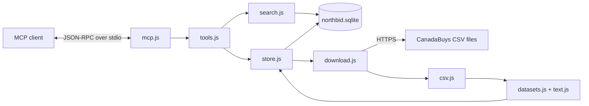

# Architecture

Northbid is one Node.js process with no third-party dependencies. It speaks MCP over stdin and stdout, keeps a SQLite database in a cache directory, and fetches public CSV files over HTTPS.

## Modules

| File | Responsibility |
|---|---|
| `server/index.js` | Entry point. Checks that the runtime's SQLite has full-text search, then wires the parts together |
| `server/mcp.js` | Newline-delimited JSON-RPC 2.0: `initialize`, `ping`, `tools/*`, `prompts/*` |
| `server/tools.js` | Tool and prompt definitions, server instructions, output shaping |
| `server/validate.js` | Argument checking against each tool's input schema |
| `server/search.js` | Builds full-text and SQL queries |
| `server/store.js` | Database schema, refresh scheduling, atomic loads |
| `server/datasets.js` | Source files, tables, and the mapping from source columns to the schema |
| `server/download.js` | HTTPS GET with certificate-chain repair |
| `server/csv.js` | Streaming CSV parser |
| `server/text.js` | Entity decoding, tag removal, multi-value cells |

## Design decisions

**No dependencies.** The server uses only Node built-ins, including `node:sqlite`. There is nothing to install, no lockfile and no native build step, and all the code that runs is in this repository and readable. The cost is a minimum Node version: 22.16, the first whose bundled SQLite includes FTS5. Node 23 does not include it.

**Knowledge lives in the server.** What a model needs to know about the data (bilingual search, closing-time offset, coverage, publication lag) is in the MCP `instructions` and tool descriptions, so every client gets it. The skill in `skills/` adds a workflow for clients that support skills.

**Local, disposable cache.** The database is a copy of public files and can be deleted at any time. A change to the schema bumps `SCHEMA_VERSION` in `store.js`, which drops and rebuilds every table on next start; there are no migrations.

**Query text is data.** User text is tokenized and each term is quoted before it reaches FTS5, so punctuation can never be read as query syntax. Only an uppercase `OR`, double-quoted phrases and a trailing `*` have meaning.

## Refresh

Each tool call that reads a table first calls `Store.refresh(table)`:

1. A file checked within its interval (2, 6 or 24 hours) is skipped.
2. Otherwise a conditional request is sent with the stored `ETag` and last-modified time. `304 Not Modified` only updates the check time.
3. A changed file is parsed completely, then loaded in one transaction: delete the rows previously loaded from that file, insert the new rows, rebuild the full-text index, record the new version. A failure at any point leaves the old data in place.
4. If the request fails and older data exists, the search proceeds on it and returns a warning. If nothing has ever been loaded, the tool returns an error.

Open and new tender notices share the `tenders` table. Rows from the open file replace any row with the same reference number; rows from the new-notices file are inserted only when the reference number is absent. Each file's rows are tagged so that reloading one never removes the other's.

Several server processes can share one database (one per client session). It runs in WAL mode with a 10-second busy timeout, and loads take a write lock for their duration.

## Downloading

`sosa.canadabuys.canada.ca` serves its certificate without the intermediate certificate that signed it. Browsers repair this by fetching the issuer from the address in the certificate's Authority Information Access field; Node does not and rejects the connection. `download.js` performs the same repair:

1. On that specific verification error, read the server certificate and its issuer address.
2. Fetch the issuer certificate.
3. Accept it only if it is currently valid, it signed the server certificate, and it was itself signed by a root authority in Node's built-in trust store.
4. Retry the request with that issuer added, and remember it for the life of the process.

The certificate is read over a connection that carries no request, and data is only ever requested over a verified connection. If any check fails, the download fails.

## Tests

`npm test` runs the suite with Node's built-in test runner against an in-memory database; it does not use the network.

- `test/csv.test.js` checks the parser against quoted commas, escaped quotes and embedded newlines, and that splitting the input into chunks at every position yields identical rows.
- `test/search.test.js` loads records through the real column mapping and checks accent-insensitive bilingual matching, that hostile query text cannot break a search, each filter, how the two tender files merge, and how standing-offer rows collapse.

## Planned

- Award notices and contract history. The complete files are 60–190 MB and the archives up to 830 MB, so these will be built into compressed database files by a scheduled GitHub Actions job and published as release assets for the server to download.
- A hosted HTTP transport, so the tools can run where local servers cannot.
